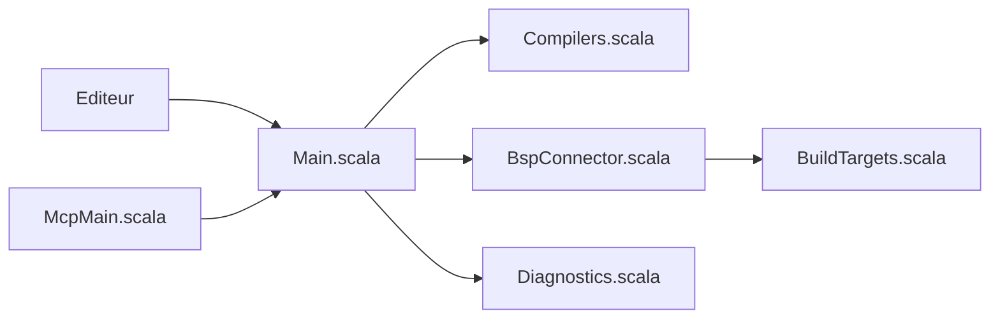

# scalameta/metals

> Serveur de langage Scala (LSP) pour utiliser Scala dans n'importe quel éditeur compatible.

## Le problème
Il faut une IDE complète pour avoir complétion, définitions et diagnostics en Scala.

## Ce que ça fait vraiment
Le README est très court et renvoie au site scalameta.org/metals. D'après l'architecture : un serveur LSP route les requêtes vers des compilateurs de présentation (complétion, définitions, références, diagnostics, actions), s'appuie sur une indexation SemanticDB et des connexions BSP aux outils de build. Un mode MCP existe pour requêter depuis des outils.

## Comment c'est branché


## Essayer
```bash
# Aucune commande dans le README : voir https://scalameta.org/metals/
```

## Coût et pièges
Gratuit. Détails d'installation non documentés dans le README.

## Ce que ce n'est pas
Pas une IDE : c'est un backend à brancher sur un éditeur.

## Alternatives
IntelliJ IDEA, cité dans le README : IDE la plus répandue, avec réimplémentation du typechecker.

## Pour toi
À surveiller : utile si tu écris du Scala/Spark dans VS Code ou Neovim, sans intérêt autrement.

