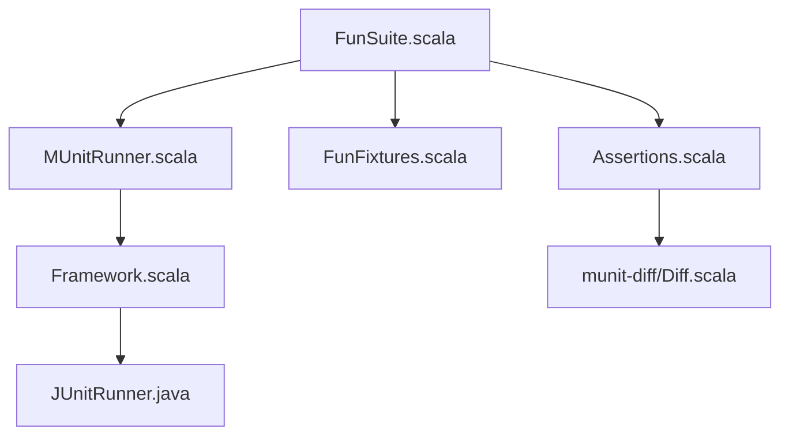

# scalameta/munit

> Scala testing library with readable errors and extensible APIs.

## The problem
Scala test failure messages are sometimes hard to act on.

## What it actually does
`FunSuite` provides tests, assertions and fixtures, run by `MUnitRunner`. On the JVM, `Framework` goes through the JUnit interface, and the `munit-diff` module computes the differences shown on failure. The README defers everything else to the website.

## How it is wired


## Trying it
```bash
# Aucune commande documentée : voir https://scalameta.org/munit/
```

## Cost and gotchas
Free. Not documented in the README: version, sbt or Scala installation.

## What it is not
Not a testing tool for other languages.

## Alternatives
No alternative named in the README.

## For you
Ignore: Scala testing framework, only useful if you write Scala/Spark.
