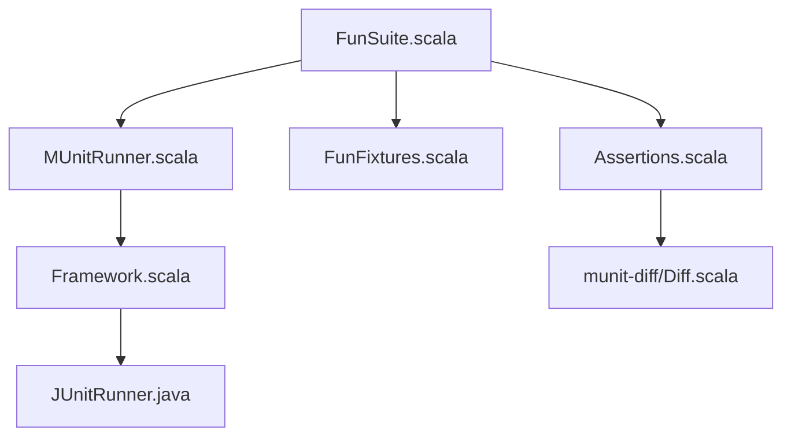

# scalameta/munit

> Bibliothèque de tests Scala aux erreurs lisibles et aux API extensibles.

## Le problème
Les messages d'échec des tests Scala sont parfois peu exploitables.

## Ce que ça fait vraiment
`FunSuite` fournit tests, assertions et fixtures, exécutés par `MUnitRunner`. Sur la JVM, `Framework` passe par l'interface JUnit, et le module `munit-diff` calcule les différences affichées en cas d'échec. Le README renvoie tout le reste au site.

## Comment c'est branché


## Essayer
```bash
# Aucune commande documentée : voir https://scalameta.org/munit/
```

## Coût et pièges
Gratuit. Non documenté dans le README : version, installation sbt ou Scala.

## Ce que ce n'est pas
Pas un outil de test pour d'autres langages.

## Alternatives
Aucune alternative nommée dans le README.

## Pour toi
À ignorer : framework de tests Scala, utile seulement si tu écris du Scala/Spark.

