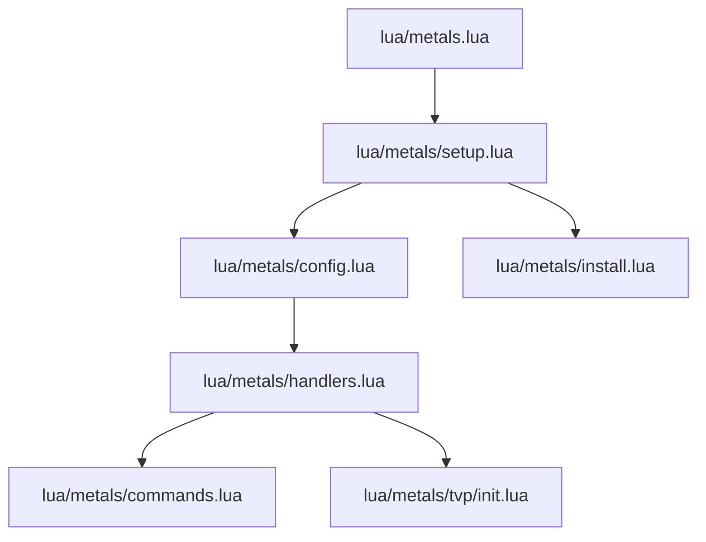

# scalameta/nvim-metals

> Neovim plugin in Lua that wires up the Scala Metals language server, for Scala developers.

## The problem
The Metals configuration provided by nvim-lspconfig is minimal, with no Metals-specific commands or extensions.

## What it actually does
Installs and updates Metals via Coursier, determines the project root, and exposes commands, a tree view, the doctor and a Telescope extension. Integrates with nvim-dap and Telescope.

## How it is wired


## Trying it
```bash
# Aucun shell : spécification lazy.nvim dans le README
# (ft = scala, sbt, java ; require("metals").initialize_or_attach(metals_config)).
```

## Cost and gotchas
Neovim 0.11 or later and Coursier installed. Do not also configure Metals through nvim-lspconfig. A JDK is useful for Metals, requirement not specified.

## What it is not
Not a language server: it drives Metals. It does not touch other languages.

## Alternatives
- nvim-lspconfig (minimal Metals configuration).

## For you
Ignore: reserved for Scala under Neovim; little interest outside that use.
