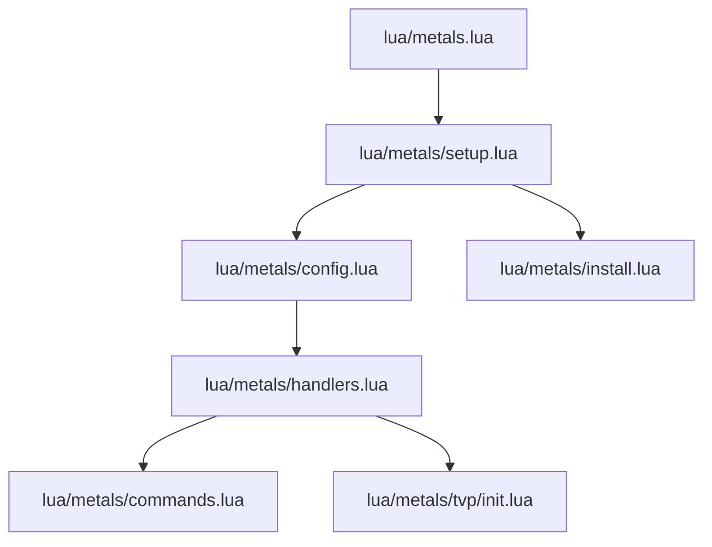

# scalameta/nvim-metals

> Plugin Neovim en Lua qui branche le serveur de langage Scala Metals, pour développeurs Scala.

## Le problème
La configuration Metals fournie par nvim-lspconfig est minimale, sans commandes ni extensions propres à Metals.

## Ce que ça fait vraiment
Installe et met à jour Metals via Coursier, détermine la racine du projet, expose des commandes, un arbre de vue, le doctor et une extension Telescope. Intégrations avec nvim-dap et Telescope.

## Comment c'est branché


## Essayer
```bash
# Aucun shell : spécification lazy.nvim dans le README
# (ft = scala, sbt, java ; require("metals").initialize_or_attach(metals_config)).
```

## Coût et pièges
Neovim 0.11 ou plus et Coursier installé. Ne pas configurer Metals aussi via nvim-lspconfig. Un JDK est utile pour Metals, besoin non précisé.

## Ce que ce n'est pas
Pas un serveur de langage : il pilote Metals. Il ne touche pas aux autres langages.

## Alternatives
- nvim-lspconfig (configuration Metals minimale).

## Pour toi
À ignorer : réservé à Scala sous Neovim ; peu d'intérêt hors de cet usage.

