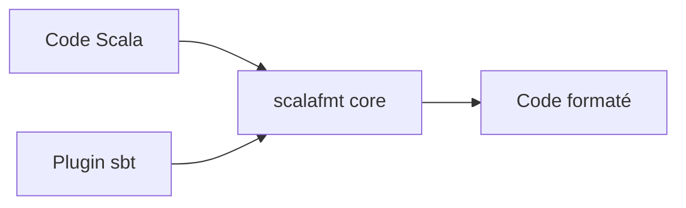

# scalameta/scalafmt

> Scala code formatter, for teams that want a uniform style.

## The problem
Scala code reviews waste time on style.

## What it actually does
The README is a contributor's one: it points to the user documentation for installation. It lists the build and test commands (`sbt compile`, `sbt test`, formatting tests), the JMH benchmark, the flamegraph reports, and the list of maintainers. The behavior of the formatter itself is not described.

## How it is wired

Diagram inferred from the project name; details not documented.

## Trying it
```bash
sbt compile
sbt test
tests/testOnly *FormatTests
./bin/run-benchmarks.sh
```

## Cost and gotchas
Free. The README describes the project's development, not its usage.

## What it is not
This README does not explain how to format your code: see the online docs.

## Alternatives
The README names no alternative.

## For you
Worth watching: probable standard for Scala/Spark, useless if you do not write Scala.
