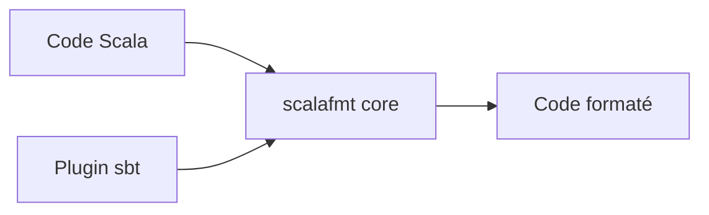

# scalameta/scalafmt

> Formateur de code Scala, pour équipes qui veulent un style uniforme.

## Le problème
Les revues de code Scala perdent du temps sur le style.

## Ce que ça fait vraiment
Le README est celui d'un contributeur : il renvoie à la documentation utilisateur pour l'installation. Il liste les commandes de build et test (`sbt compile`, `sbt test`, tests de formatage), le benchmark JMH, les rapports flamegraph, et la liste des mainteneurs. Le comportement du formateur lui-même n'est pas décrit.

## Comment c'est branché

Schéma déduit du nom de projet ; détails non documentés.

## Essayer
```bash
sbt compile
sbt test
tests/testOnly *FormatTests
./bin/run-benchmarks.sh
```

## Coût et pièges
Gratuit. Le README décrit le développement du projet, pas son usage.

## Ce que ce n'est pas
Ce README n'explique pas comment formater son code : voir la doc en ligne.

## Alternatives
Le README ne nomme pas d'alternative.

## Pour toi
À surveiller : standard probable pour Scala/Spark, sans utilité si tu n'écris pas de Scala.

