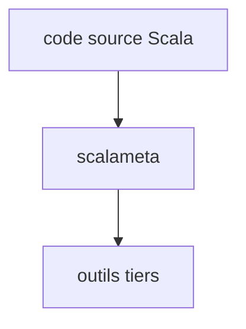

# scalameta/scalameta

> Scala library to parse and manipulate source code, the foundation of many tools.

## The problem
Without this library, writing tools that read Scala code (formatting, refactoring) means rebuilding a parser.

## What it actually does
The README is very short: it points to the documentation on scalameta.org and to a tutorial, and lists the maintainers. Nothing more is documented here about features or installation.

## How it is wired
Simplified diagram based on the sheet, no diagram provided.

## Trying it
No command documented in the README.

## Cost and gotchas
Free. Compilation and use through sbt: not documented here.

## What it is not
Not a tool usable on its own: it is a base for building tools.

## Alternatives
No alternative named in the README.

## For you
Ignore: Scala ecosystem, unrelated to a common data / AI / MLOps path. Too little material to judge further.
