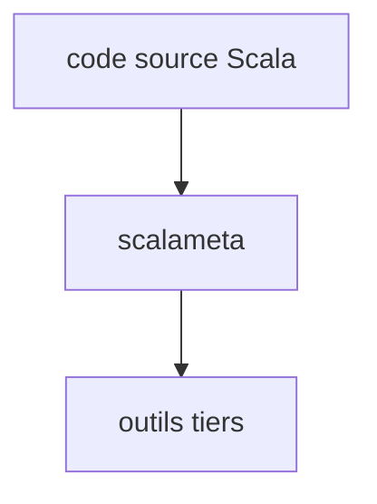

# scalameta/scalameta

> Bibliothèque Scala pour analyser et manipuler du code source, base de nombreux outils.

## Le problème
Sans cette bibliothèque, écrire des outils qui lisent du code Scala (formatage, refactoring) oblige à refaire un analyseur.

## Ce que ça fait vraiment
Le README est très court : il renvoie à la documentation sur scalameta.org et à un tutoriel, et liste les mainteneurs. Rien de plus n'est documenté ici sur les fonctions ou l'installation.

## Comment c'est branché
Schéma simplifié d'après la fiche, sans diagramme fourni.

## Essayer
Aucune commande documentée dans le README.

## Coût et pièges
Gratuit. Compilation et usage via sbt : non documentés ici.

## Ce que ce n'est pas
Pas un outil utilisable seul : c'est une base pour construire des outils.

## Alternatives
Aucune alternative nommée dans le README.

## Pour toi
Ignorer : écosystème Scala, sans lien avec un parcours data / IA / MLOps courant. Matière trop mince pour juger plus.

