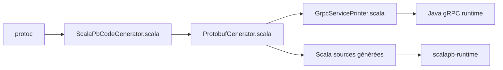

# scalapb/ScalaPB

> protoc plugin that generates Scala case classes, parsers and serializers from protobuf files.

## The problem
Using Protocol Buffers in Scala with idiomatic types, without going through the Java classes.

## What it actually does
Generates case classes, parsers and serializers for proto2 and proto3, with lenses to modify nested structures, gRPC integration, Scala.js, JSON conversion and SparkSQL compatibility via a helper library. One Scala file per message improves incremental compilation. Optional conversion to the Java classes.

## How it is wired


## Trying it
```bash
sbt test
./e2e.sh
```
```scala
Compile / PB.targets := Seq(
  scalapb.gen() -> (Compile / sourceManaged).value / "scalapb"
)
```

## Cost and gotchas
Free. The README's version table (0.6.x, Protobuf 3.5) is visibly outdated, while the example cites plugin 0.11.3.

## What it is not
Not a Python tool nor a data format: it only serves the Scala/JVM world.

## Alternatives
No alternative named in the README (the Java protobuf generated by default is the point of comparison).

## For you
Ignore unless you do Spark in Scala with protobuf: useful there, off-topic for a Python stack.
