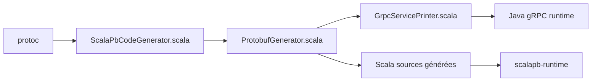

# scalapb/ScalaPB

> Plugin protoc qui génère des case classes Scala, parseurs et sérialiseurs à partir de fichiers protobuf.

## Le problème
Utiliser Protocol Buffers en Scala avec des types idiomatiques, sans passer par les classes Java.

## Ce que ça fait vraiment
Génère case classes, parseurs et sérialiseurs pour proto2 et proto3, avec lentilles pour modifier des structures imbriquées, intégration gRPC, Scala.js, conversion JSON et compatibilité SparkSQL via une librairie d'aide. Un fichier Scala par message améliore la compilation incrémentale. Conversion optionnelle vers les classes Java.

## Comment c'est branché


## Essayer
```bash
sbt test
./e2e.sh
```
```scala
Compile / PB.targets := Seq(
  scalapb.gen() -> (Compile / sourceManaged).value / "scalapb"
)
```

## Coût et pièges
Gratuit. Le tableau des versions du README (0.6.x, Protobuf 3.5) est visiblement daté, alors que l'exemple cite le plugin 0.11.3.

## Ce que ce n'est pas
Pas un outil Python ni un format de données : il ne sert que le monde Scala/JVM.

## Alternatives
Aucune alternative nommée dans le README (le protobuf Java généré par défaut est le point de comparaison).

## Pour toi
À ignorer sauf si tu fais du Spark en Scala avec protobuf : utile là, hors sujet pour un stack Python.

