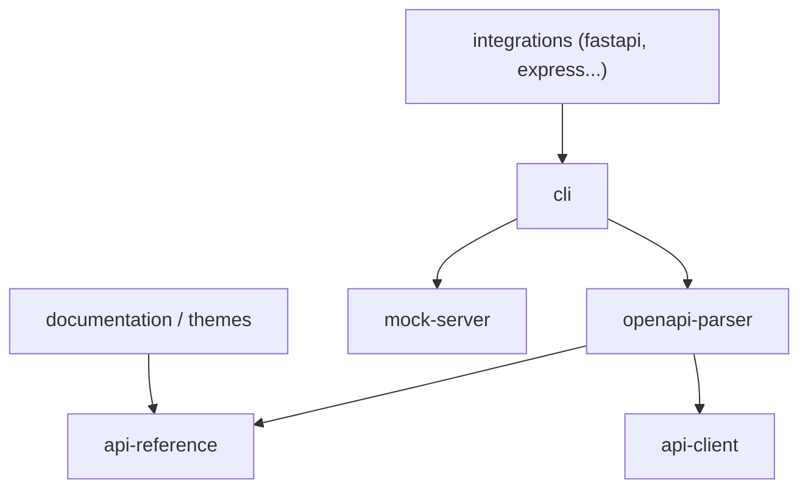

# scalar/scalar

> Interactive API reference and offline API client built from OpenAPI documents, for teams that publish APIs.

## The problem
Classic Swagger documentation is hard to read and has no built-in testing tool.

## What it actually does
Renders an OpenAPI document as an interactive reference with call testing and code examples. Integrations for many frameworks (FastAPI, Express, Hono, Django, Spring Boot...). An offline API client (Windows, macOS, Linux), a mock server, a CLI and a managed hosting offer, free or paid, also exist.

## How it is wired
Diagram based on the code's diagram, simplified.



## Trying it
```bash
npx skills add scalar/scalar --skill scalar-api-reference
```
Or an HTML page that loads `@scalar/api-reference/esm.js` from jsDelivr and calls `createApiReference`.

## Cost and gotchas
Open source MIT; managed hosting has a free tier and paid plans. The HTML example uses a CDN and a third-party proxy (proxy.scalar.com) to avoid CORS.

## What it is not
Not an OpenAPI specification generator: an existing document (or a tool to produce one) is required. Not just documentation: hosting is a separate product.

## Alternatives
- Postman: cited as the equivalent of the API client.

## For you
Worth watching: useful for documenting and testing the API of a model service (FastAPI), with a setup in a few lines.
