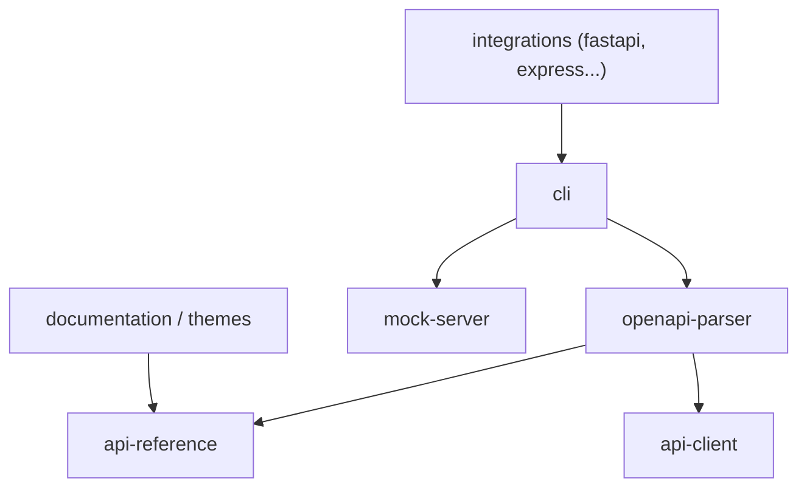

# scalar/scalar

> Référence d'API interactive et client d'API hors ligne à partir de documents OpenAPI, pour équipes qui publient des API.

## Le problème
Les documentations Swagger classiques sont peu lisibles et sans outil de test intégré.

## Ce que ça fait vraiment
Affiche un document OpenAPI en référence interactive avec test d'appels et exemples de code. Intégrations pour de nombreux frameworks (FastAPI, Express, Hono, Django, Spring Boot...). Un client d'API hors ligne (Windows, macOS, Linux), un serveur de mock, un CLI et un hébergement géré gratuit ou payant existent.

## Comment c'est branché
Schéma d'après le diagramme du code, simplifié.



## Essayer
```bash
npx skills add scalar/scalar --skill scalar-api-reference
```
Ou une page HTML qui charge `@scalar/api-reference/esm.js` depuis jsDelivr et appelle `createApiReference`.

## Coût et pièges
Open source MIT ; l'hébergement géré a une offre gratuite et des offres payantes. L'exemple HTML utilise un CDN et un proxy tiers (proxy.scalar.com) pour éviter CORS.

## Ce que ce n'est pas
Pas un générateur de spécification OpenAPI : il faut un document existant (ou un outil pour le produire). Pas seulement une documentation : l'hébergement est un produit à part.

## Alternatives
- Postman : cité comme équivalent du client d'API.

## Pour toi
À surveiller : utile pour documenter et tester l'API d'un service de modèles (FastAPI), avec un setup en peu de lignes.

