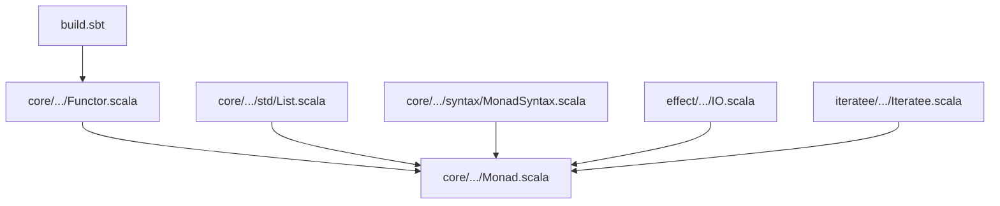

# scalaz/scalaz

> Scala library for pure functional programming: type classes and data structures.

## The problem
The Scala standard library lacks fundamental type classes (Functor, Monad) and purely functional data structures.

## What it actually does
Scalaz defines a hierarchy of type classes with their instances for the standard library, monad transformers and syntax that can be imported à la carte. Stable version 7.3.9, built for Scala 2.12, 2.13, 3, Scala.js and Scala Native. The `effect` and `iteratee` modules are separate.

## How it is wired


## Trying it
```scala
libraryDependencies += "org.scalaz" %% "scalaz-core" % "7.3.9"
```
```scala
import scalaz._
import std.option._, std.list._
Apply[Option].apply2(some(1), some(2))((a, b) => a + b)
```

## Cost and gotchas
Free. Requires sbt and the JVM (outside the prerequisites list). License detected but not identified by GitHub: to be checked. Steep learning curve.

## What it is not
Not a data tool: it is a functional typing library for Scala.

## Alternatives
No alternative named in the README.

## For you
Ignore: reserved for Scala developers and of little use in data or AI.
