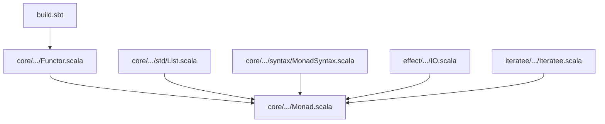

# scalaz/scalaz

> Bibliothèque Scala de programmation fonctionnelle pure : classes de types et structures de données.

## Le problème
La bibliothèque standard Scala manque de classes de types fondamentales (Functor, Monad) et de structures purement fonctionnelles.

## Ce que ça fait vraiment
Scalaz définit une hiérarchie de classes de types avec leurs instances pour la bibliothèque standard, des transformateurs de monades et une syntaxe importable à la carte. Version stable 7.3.9, compilée pour Scala 2.12, 2.13, 3, Scala.js et Scala Native. Les modules `effect` et `iteratee` sont séparés.

## Comment c'est branché


## Essayer
```scala
libraryDependencies += "org.scalaz" %% "scalaz-core" % "7.3.9"
```
```scala
import scalaz._
import std.option._, std.list._
Apply[Option].apply2(some(1), some(2))((a, b) => a + b)
```

## Coût et pièges
Gratuit. Demande sbt et la JVM (hors liste de prérequis). Licence détectée mais non identifiée par GitHub : à vérifier. Courbe d'apprentissage forte.

## Ce que ce n'est pas
Pas un outil de données : c'est une bibliothèque de typage fonctionnel pour Scala.

## Alternatives
Aucune alternative nommée dans le README.

## Pour toi
Ignorer : réservé aux développeurs Scala et peu utile en data ou IA.

