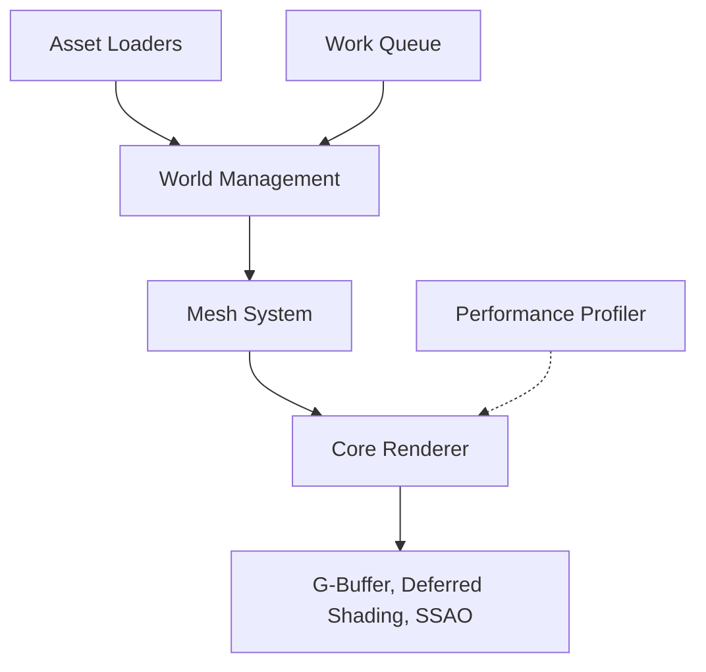

# scallyw4g/bonsai

> Voxel engine for very large worlds, written in C++ with almost no dependencies, for graphics developers.

## The problem
Conventional voxel engines hit a ceiling on world size and view distance.

## What it actually does
An engine with deferred rendering, HDR lighting, shadows, ambient occlusion, GPU terrain generation in GLSL shaders, world editing via SDF, hot reloading of code and shaders, an asynchronous task system and a profiler. It advertises worlds of roughly one billion blocks per side.

## How it is wired

## Trying it
No command documented in the README: it points to binaries and a Build From Source section without the commands.

## Cost and gotchas
Free. Requires clang++ 18.1 or later to build, Windows or Linux. Version 2.0.0 is in alpha: a rewrite is under way.

## What it is not
Not a game: an engine. WTFPL license, to be checked for commercial use.

## Alternatives
No alternative named in the README.

## For you
Ignore: a low-level graphics engine, outside your data/AI profile, interesting only for GPU terrain generation.
