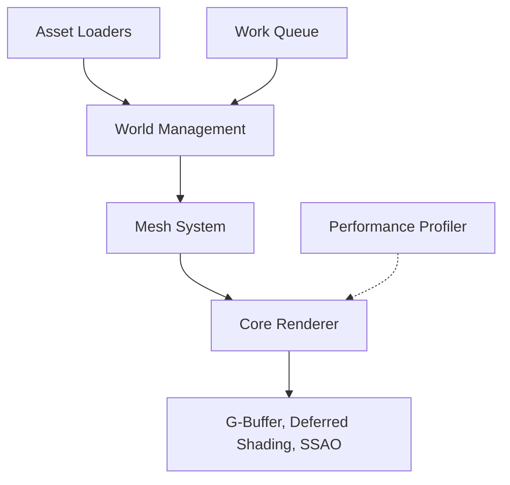

# scallyw4g/bonsai

> Moteur de voxels à très grands mondes, écrit en C++ presque sans dépendances, pour développeurs graphiques.

## Le problème
Les moteurs de voxels classiques plafonnent en taille de monde et en distance de vue.

## Ce que ça fait vraiment
Moteur avec rendu différé, éclairage HDR, ombres, occlusion ambiante, génération de terrain sur GPU en shaders GLSL, édition de monde par SDF, rechargement à chaud du code et des shaders, système de tâches asynchrones et profileur. Annonce des mondes d'environ un milliard de blocs de côté.

## Comment c'est branché

## Essayer
Aucune commande documentée dans le README : il renvoie vers des binaires et une section Build From Source sans les commandes.

## Coût et pièges
Gratuit. Requiert clang++ 18.1 ou plus pour compiler, Windows ou Linux. La version 2.0.0 est en alpha : réécriture en cours.

## Ce que ce n'est pas
Pas un jeu : un moteur. Licence WTFPL, à vérifier pour un usage commercial.

## Alternatives
Aucune alternative nommée dans le README.

## Pour toi
Ignorer : moteur graphique de bas niveau, hors de ton profil data/IA, intéressant seulement pour la génération de terrain sur GPU.

