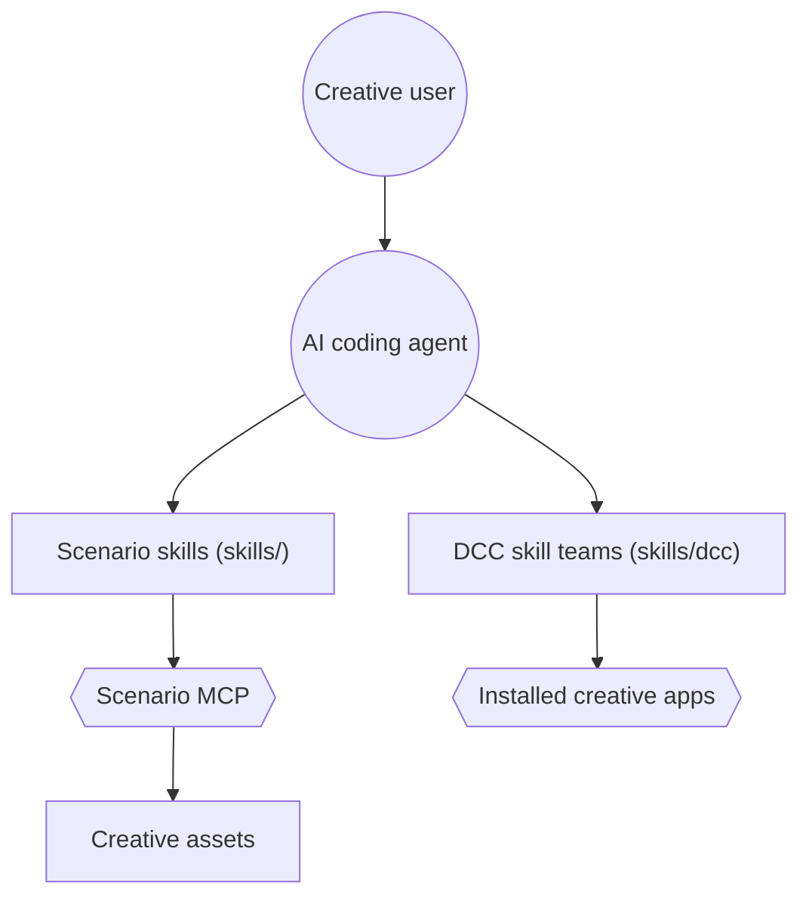

# scenario-labs/skills

> Coding-agent skills to generate images, video, audio and 3D through the Scenario MCP server.

## The problem
A coding agent cannot drive the Scenario platform on its own: models, formats, costs, generation loops.

## What it actually does
- Dozens of skills (`scenario`, `scenario-image`, `scenario-video`, `scenario-3d`…) that guide the use of the Scenario MCP.
- Skills per model family (GPT Image, Seedream, Veo, Kling, etc.).
- "Expert tools" that drive local software: ZBrush, Blender, Maya, Unreal, Unity, Godot, Roblox Studio.
- Updates via releases (release-please); installation can be pinned to a commit.

## How it is wired


## Trying it
```bash
npx skills add scenario-labs/skills --skill scenario
claude mcp add --transport http scenario https://mcp.scenario.com/mcp
```

## Cost and gotchas
A Scenario account (OAuth or API key) is required; generations are billed in credits on the Scenario side (the README mentions costs and caps). The expert tools require the application to be installed.

## What it is not
Not a generator: without the Scenario service, the skills are useless. The links between skills are not established by the sampled code.

## Alternatives
- vercel-labs/skills: the `npx skills` installer, cited by the README (an installation tool, not an equivalent).

## For you
Ignore for a data / AI / MLOps profile: dependence on a paid creative SaaS, game and media content use cases, no link with ML in production.
