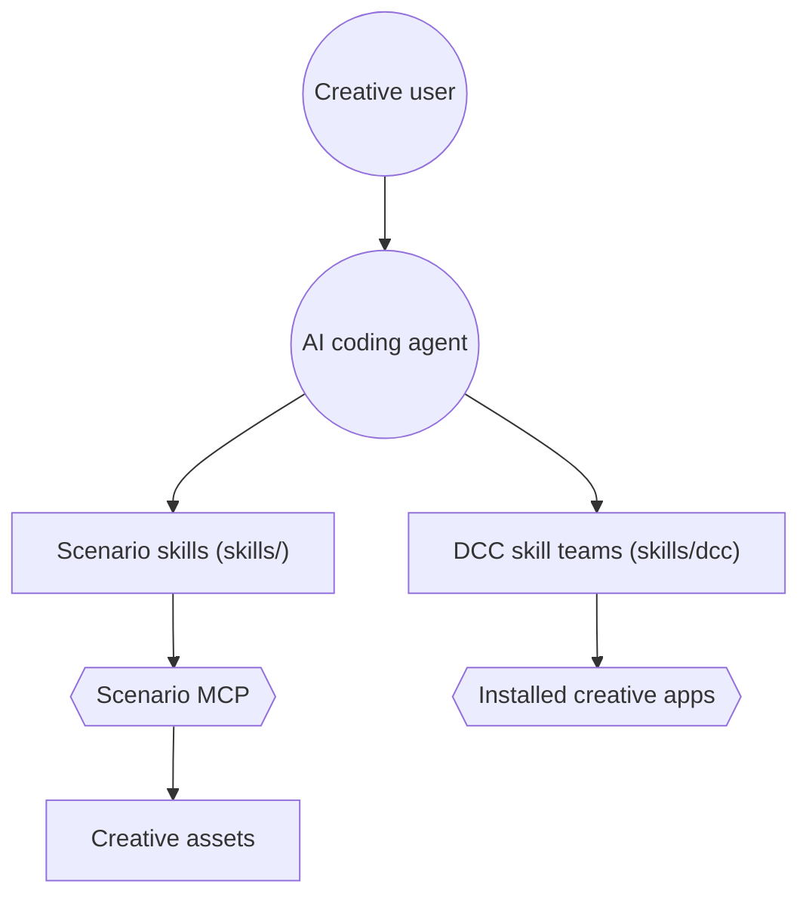

# scenario-labs/skills

> Skills d'agents de code pour générer images, vidéo, audio et 3D via le serveur MCP de Scenario.

## Le problème
Un agent de code ne sait pas piloter seul la plateforme Scenario : modèles, formats, coûts, boucles de génération.

## Ce que ça fait vraiment
- Des dizaines de skills (`scenario`, `scenario-image`, `scenario-video`, `scenario-3d`…) qui guident l'usage du MCP Scenario.
- Des skills par famille de modèles (GPT Image, Seedream, Veo, Kling, etc.).
- Des « expert tools » qui pilotent des logiciels locaux : ZBrush, Blender, Maya, Unreal, Unity, Godot, Roblox Studio.
- Mises à jour via releases (release-please) ; installation pinnable sur un commit.

## Comment c'est branché


## Essayer
```bash
npx skills add scenario-labs/skills --skill scenario
claude mcp add --transport http scenario https://mcp.scenario.com/mcp
```

## Coût et pièges
Compte Scenario (OAuth ou clé d'API) obligatoire ; les générations sont facturées en crédits côté Scenario (le README parle de coûts et de plafonds). Les expert tools exigent l'application installée.

## Ce que ce n'est pas
Pas un générateur : sans le service Scenario, les skills ne servent à rien. Les liens entre skills ne sont pas établis par le code échantillonné.

## Alternatives
- vercel-labs/skills : l'installateur `npx skills`, cité par le README (outil d'installation, pas un équivalent).

## Pour toi
À ignorer pour un profil data / IA / MLOps : dépendance à un SaaS créatif payant, cas d'usage jeux et contenu média, aucun lien avec le ML en production.

