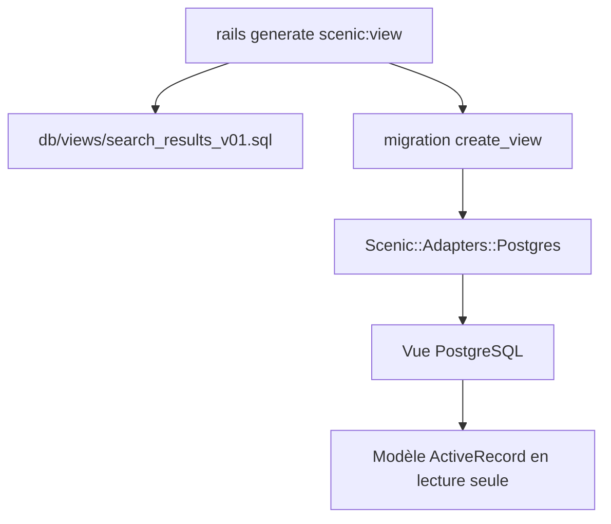

# scenic-views/scenic

> Rails gem that versions PostgreSQL SQL views in migrations, for Rails developers.

## The problem
SQL views in a Rails app force you to switch the schema to SQL format, or to duplicate queries from migration to migration.

## What it actually does
Adds `create_view`, `update_view`, `replace_view` and `drop_view` to `ActiveRecord::Migration`. Each version of a view lives in a `db/views/*_vNN.sql` file. Also handles materialised views, with refresh and a `side_by_side` strategy. A PostgreSQL adapter is provided; other gems can add more.

## How it is wired
Simplified diagram based on the sheet, no diagram provided.


## Trying it
```bash
rails generate scenic:view search_results
rake db:migrate
rails generate scenic:view search_results --replace
rails generate scenic:view search_results --materialized --side-by-side
```

## Cost and gotchas
Free. A view frozen with `SELECT table.*` does not see columns added afterwards. A model backed by a view needs a declared primary key for `find`, `first` and `last`.

## What it is not
Not a generic data tool: it is only useful inside a Rails app. Native support covers only PostgreSQL. A materialised view cannot be replaced in place.

## Alternatives
- `fx`: same idea for database functions and triggers (cited in the README).

## For you
Ignore for a data / AI / MLOps profile: it is a Rails migrations tool, only useful if you maintain a Rails app on PostgreSQL.
