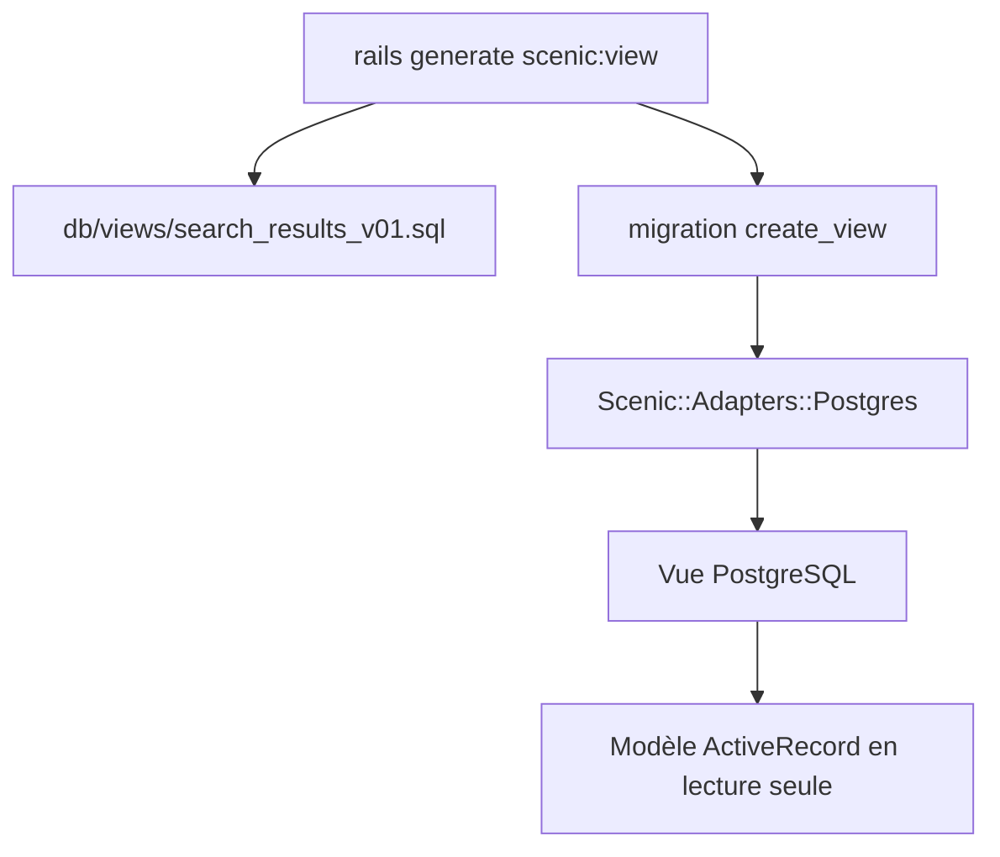

# scenic-views/scenic

> Gem Rails qui versionne les vues SQL PostgreSQL dans les migrations, pour les développeurs Rails.

## Le problème
Les vues SQL d'une appli Rails obligent à passer le schéma en format SQL, ou à dupliquer les requêtes de migration en migration.

## Ce que ça fait vraiment
Ajoute à `ActiveRecord::Migration` les méthodes `create_view`, `update_view`, `replace_view` et `drop_view`. Chaque version d'une vue vit dans un fichier `db/views/*_vNN.sql`. Gère aussi les vues matérialisées, avec rafraîchissement et stratégie `side_by_side`. Adaptateur PostgreSQL fourni, d'autres gems peuvent en ajouter.

## Comment c'est branché
Schéma simplifié d'après la fiche, sans diagramme fourni.


## Essayer
```bash
rails generate scenic:view search_results
rake db:migrate
rails generate scenic:view search_results --replace
rails generate scenic:view search_results --materialized --side-by-side
```

## Coût et pièges
Gratuit. Une vue figée avec `SELECT table.*` ne voit pas les colonnes ajoutées après coup. Un modèle adossé à une vue demande une clé primaire déclarée pour `find`, `first` et `last`.

## Ce que ce n'est pas
Pas un outil de données générique : il ne sert que dans une appli Rails. Le support natif ne couvre que PostgreSQL. Une vue matérialisée ne se remplace pas en place.

## Alternatives
- `fx` : même idée pour les fonctions et déclencheurs de base de données (cité dans le README).

## Pour toi
À ignorer pour un profil data / IA / MLOps : c'est un outil de migrations Rails, utile seulement si tu maintiens une appli Rails sur PostgreSQL.

