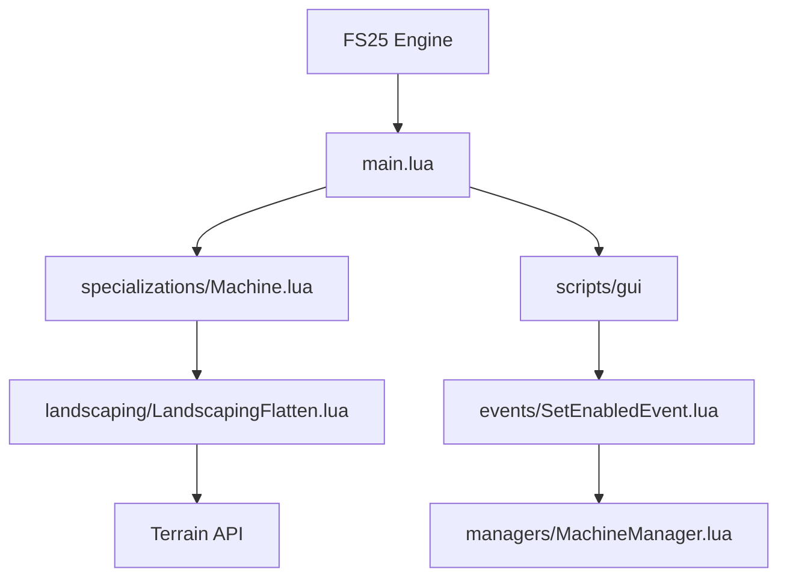

# scfmod/FS25_TerraFarm

> Mod for Farming Simulator 25 that lets you reshape the terrain with the game's vehicles.

## The problem
The game's standard terraforming tool is considered impractical for sculpting terrain.

## What it actually does
The FS25 engine loads main.lua, which registers the Machine and Surveyor specializations and the interface. Events (SetEnabledEvent, SetMaterialsEvent) update the managers, then the algorithms (Flatten, Raise, Slope, Smooth, Paint) call the terrain API. Multiplayer supported.

## How it is wired


## Trying it
```bash
# Télécharger FS25_0_TerraFarm.zip et le copier dans le dossier mods de FS25
```

## Cost and gotchas
Requires the game Farming Simulator 25 (paid). The "Landscaping areas" and "Water planes" sections are marked TODO. The README text forbids uploading to monetized upload services.

## What it is not
Not a geomatics or data tool: a video game mod in Lua.

## Alternatives
No alternative named.

## For you
Ignore: video game mod, no connection with your work.
