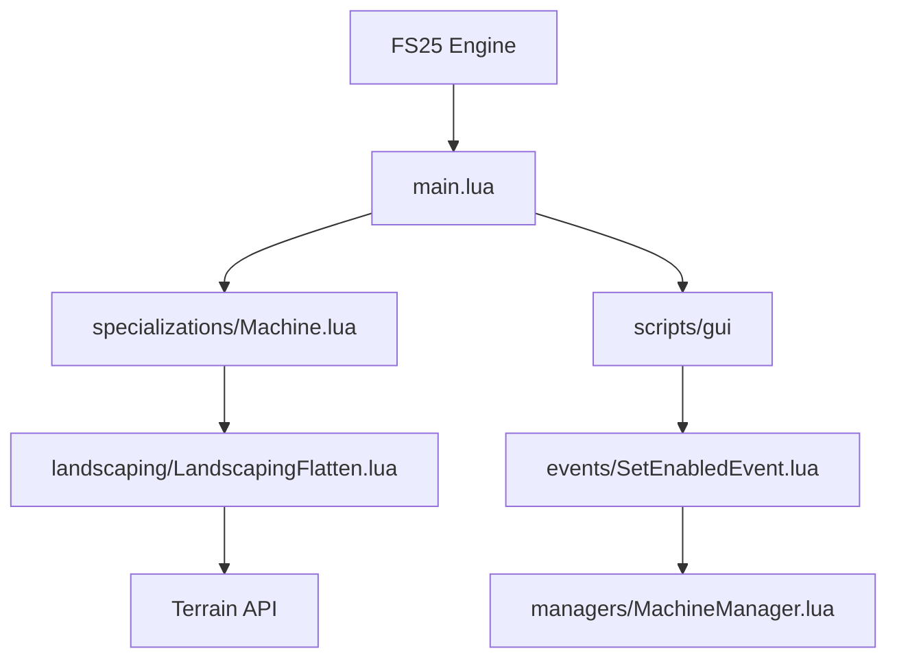

# scfmod/FS25_TerraFarm

> Mod pour Farming Simulator 25 qui permet de remodeler le terrain avec les engins du jeu.

## Le problème
L'outil de terrassement standard du jeu est jugé peu pratique pour sculpter le terrain.

## Ce que ça fait vraiment
Le moteur FS25 charge main.lua, qui enregistre les spécialisations Machine et Surveyor et l'interface. Les événements (SetEnabledEvent, SetMaterialsEvent) mettent à jour les gestionnaires, puis les algorithmes (Flatten, Raise, Slope, Smooth, Paint) appellent l'API terrain. Multijoueur pris en charge.

## Comment c'est branché


## Essayer
```bash
# Télécharger FS25_0_TerraFarm.zip et le copier dans le dossier mods de FS25
```

## Coût et pièges
Nécessite le jeu Farming Simulator 25 (payant). Sections « Landscaping areas » et « Water planes » marquées TODO. Le texte du README interdit l'envoi sur des services d'upload monétisés.

## Ce que ce n'est pas
Pas un outil de géomatique ni de data : un mod de jeu vidéo en Lua.

## Alternatives
Aucune alternative nommée.

## Pour toi
À ignorer : mod de jeu vidéo, aucun lien avec ton métier.

