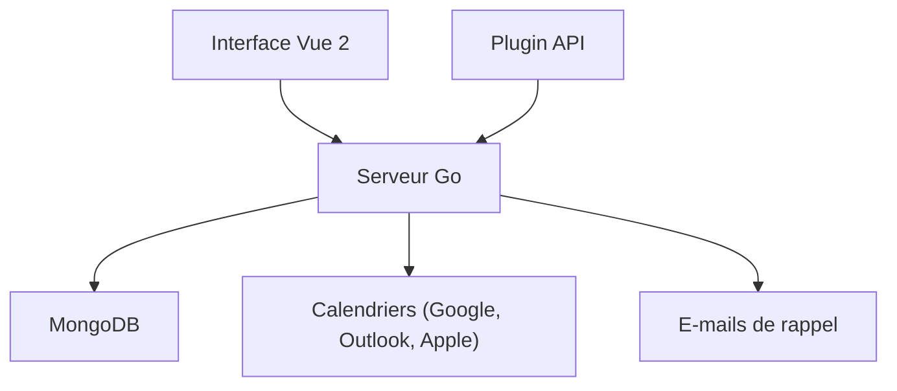

# schej-it/timeful.app

> Self-hostable availability poll that finds the best meeting slot for a group.

## The problem
Finding a time that suits a whole group by exchanging messages is slow and gets lost across time zones.

## What it actually does
A web application (Vue 2, Go, MongoDB, TailwindCSS) where everyone indicates their availability. It shows overlaps, handles "if needed" slots, time zones, email reminders and CSV export. It connects to Google Calendar, Outlook and Apple Calendar, and exposes a plugin API.

## How it is wired
Simplified diagram based on the card, no diagram provided.



## Trying it
```bash
# Aucune commande dans le README : suivre le Deployment Guide
# (Docker Compose ou NixOS).
```

## Cost and gotchas
Free when self-hosted; a hosted version exists at timeful.app. Calendar integrations assume third-party accounts.

## What it is not
It is not a full team scheduling tool: it is an availability poll. The AGPL license applies to modifications served over a network.

## Alternatives
No alternative named in the README.

## For you
Ignore for a data / AI / MLOps profile: a meeting scheduling tool, unrelated to your work.
