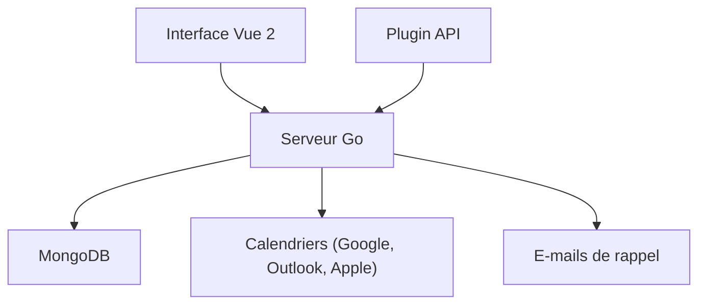

# schej-it/timeful.app

> Sondage de disponibilités auto-hébergeable qui trouve le meilleur créneau de réunion pour un groupe.

## Le problème
Trouver un horaire qui convient à tout un groupe par échanges de messages est long et se perd entre fuseaux horaires.

## Ce que ça fait vraiment
Une application web (Vue 2, Go, MongoDB, TailwindCSS) où chacun indique ses disponibilités. Elle montre les chevauchements, gère les créneaux « si nécessaire », les fuseaux, les rappels par e-mail et l'export CSV. Elle se relie à Google Calendar, Outlook et Apple Calendar, et expose une API de plugins.

## Comment c'est branché
Schéma simplifié d'après la fiche, sans diagramme fourni.



## Essayer
```bash
# Aucune commande dans le README : suivre le Deployment Guide
# (Docker Compose ou NixOS).
```

## Coût et pièges
Gratuit en auto-hébergement ; une version hébergée existe sur timeful.app. Les intégrations de calendrier supposent des comptes tiers.

## Ce que ce n'est pas
Ce n'est pas un outil de planification d'équipe complet : c'est un sondage de disponibilité. La licence AGPL s'applique aux modifications servies en réseau.

## Alternatives
Aucune alternative nommée dans le README.

## Pour toi
À ignorer pour un profil data / IA / MLOps : un outil de planification de réunions, sans lien avec ton travail.

