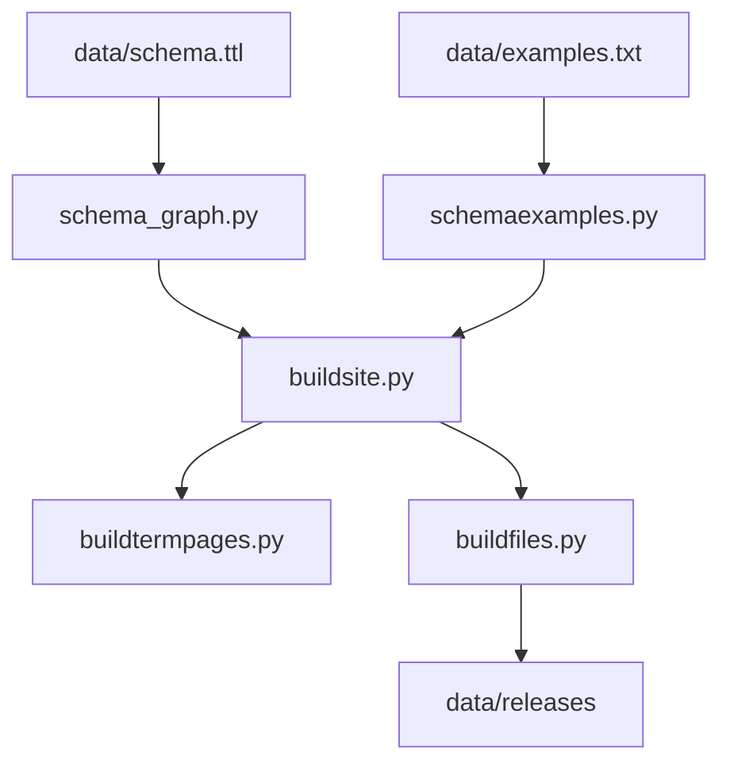

# schemaorg/schemaorg

> Source repository of the Schema.org vocabulary: schemas, examples and the software that publishes the site.

## The problem
Describing web content in a common way for search engines and other consumers requires a shared, versioned vocabulary.

## What it actually does
Contains the schemas in RDF/Turtle (`data/schema.ttl`), the examples (`data/examples.txt`), the extensions and the release snapshots. Python scripts (`software/util/`) build a static site and the publication files, validated by tests. Deployment targets Google App Engine.

## How it is wired

## Trying it
No command documented in the README: see `SOFTWARE_README.md`. The local site opens at http://localhost:8080/.

## Cost and gotchas
Free. Python 3.11 or later in a Linux-like environment; on Windows, WSL2. Deployment on appspot.com: possible bill.

## What it is not
Not the site itself nor a tool for marking up your pages: it is the repository of the definitions. Proposals for new terms are often noted then closed.

## Alternatives
Wikidata and GS1, cited in the README as other vocabularies.

## For you
Worth watching: useful reference for JSON-LD or knowledge graphs, with no direct tool to install.
