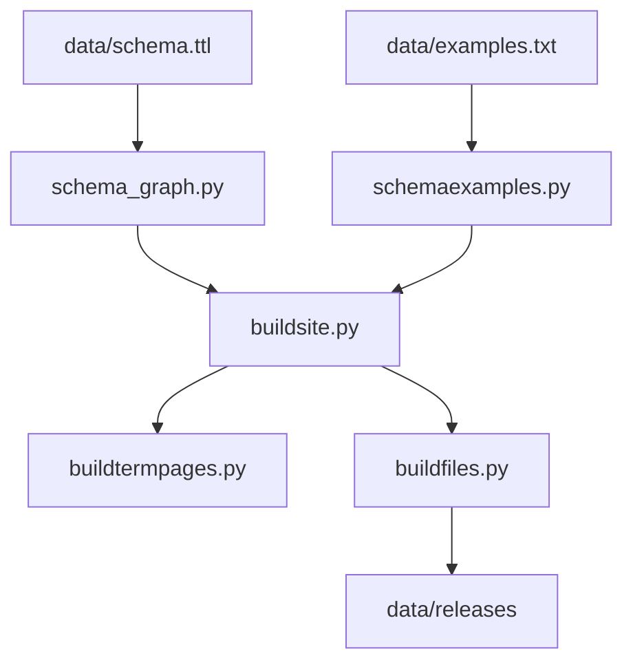

# schemaorg/schemaorg

> Dépôt source du vocabulaire Schema.org : schémas, exemples et logiciel qui publient le site.

## Le problème
Décrire le contenu web de façon commune pour les moteurs de recherche et autres consommateurs demande un vocabulaire partagé et versionné.

## Ce que ça fait vraiment
Contient les schémas en RDF/Turtle (`data/schema.ttl`), les exemples (`data/examples.txt`), les extensions et les instantanés de versions. Des scripts Python (`software/util/`) construisent un site statique et les fichiers de publication, validés par des tests. Le déploiement cible Google App Engine.

## Comment c'est branché

## Essayer
Aucune commande documentée dans le README : voir `SOFTWARE_README.md`. Le site local s'ouvre sur http://localhost:8080/.

## Coût et pièges
Gratuit. Python 3.11 ou plus dans un environnement de type Linux ; sous Windows, WSL2. Déploiement sur appspot.com : facture éventuelle.

## Ce que ce n'est pas
Ce n'est pas le site lui-même ni un outil pour marquer ses pages : c'est le dépôt des définitions. Les propositions de nouveaux termes sont souvent notées puis fermées.

## Alternatives
Wikidata et GS1, cités dans le README comme autres vocabulaires.

## Pour toi
À surveiller : référence utile pour du JSON-LD ou des graphes de connaissances, sans usage direct à installer.

