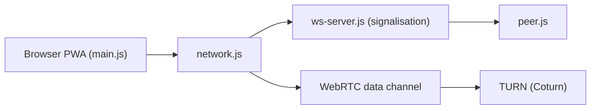

# schlagmichdoch/PairDrop

> Peer-to-peer file sharing in the browser, AirDrop-style, on a local network or over the Internet.

## The problem
Sending a file from a phone to a computer without an account or a cable.

## What it actually does
A web app (PWA) finds devices on the same network, in a temporary public room, or paired by code. Files travel over WebRTC; the Node server only handles signalling over WebSocket. A TURN server (Coturn) can help outside the local network.

## How it is wired

## Trying it
No command in the README; self-hosting with Docker or Node.js is described in the FAQ.

## Cost and gotchas
Free. Going beyond the local network may require deploying a TURN server. Last push on 2026-04-22.

## What it is not
Not storage or a backup service: nothing is kept on the server side. GPL-3.0 license.

## Alternatives
Snapdrop, of which PairDrop is a fork, is cited by the README.

## For you
Ignore: a personal file-sharing tool, of no use for a data/AI pipeline.
