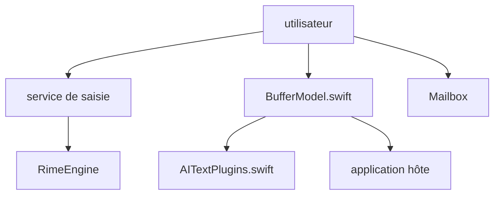

# scholay/rimes

> Cross-platform Chinese input method based on Rime, with a buffer, clipboard and AI mailbox.

## The problem
Translating, rephrasing or generating text forces you to leave the current application.

## What it actually does
An input engine (pinyin, Wubi 86, double pinyin) for macOS, iOS, Android, Windows and Linux. Three spaces: a Buffer (text reviewed, translated or generated before sending), a Capsule (clipboard history, notes, passwords) and a Mailbox (AI conversations). Connectors go to Codex, Claude Code or an OpenAI-compatible API. The README is in Chinese.

## How it is wired


## Trying it
```bash
git clone --recurse-submodules https://github.com/scholay/xsime.git
cd xsime
./build_install.sh
```

## Cost and gotchas
The AI features require a key or a configured command-line tool, at your expense. The project offers a sync subscription. The Windows EXE is not signed. App crashes on macOS 27 have been reported.

## What it is not
Not just a keyboard: it bundles a clipboard and passwords. The author says they relied heavily on AI to write the code.

## Alternatives
No alternative named in the README, apart from RIME and iRime, from which it derives.

## For you
Ignore: Chinese input method, outside the data / AI / MLOps scope, and a clipboard with passwords is a sensitive point.
