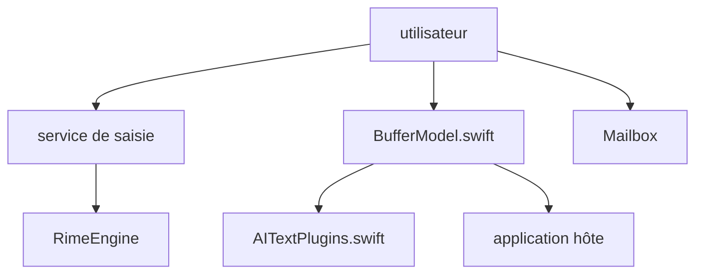

# scholay/rimes

> Méthode de saisie chinoise multiplateforme basée sur Rime, avec tampon, presse-papiers et boîte aux lettres IA.

## Le problème
Traduire, reformuler ou générer du texte oblige à quitter l'application en cours.

## Ce que ça fait vraiment
Un moteur de saisie (pinyin, Wubi 86, double pinyin) pour macOS, iOS, Android, Windows et Linux. Trois espaces : un Buffer (texte revu, traduit ou généré avant envoi), une Capsule (historique du presse-papiers, notes, mots de passe) et une Mailbox (conversations IA). Les connecteurs vont vers Codex, Claude Code ou une API compatible OpenAI. Le README est en chinois.

## Comment c'est branché


## Essayer
```bash
git clone --recurse-submodules https://github.com/scholay/xsime.git
cd xsime
./build_install.sh
```

## Coût et pièges
Les fonctions IA demandent une clé ou un outil en ligne de commande configuré, à ta charge. Le projet offre un abonnement de synchronisation. Le EXE Windows n'est pas signé. Des plantages d'apps sous macOS 27 sont signalés.

## Ce que ce n'est pas
Pas seulement un clavier : il embarque un presse-papiers et des mots de passe. L'auteur dit avoir beaucoup recouru à des IA pour coder.

## Alternatives
Aucune alternative nommée dans le README, hormis RIME et iRime dont il dérive.

## Pour toi
Ignorer : méthode de saisie chinoise, hors périmètre data / IA / MLOps, et un presse-papiers avec mots de passe est un point sensible.

