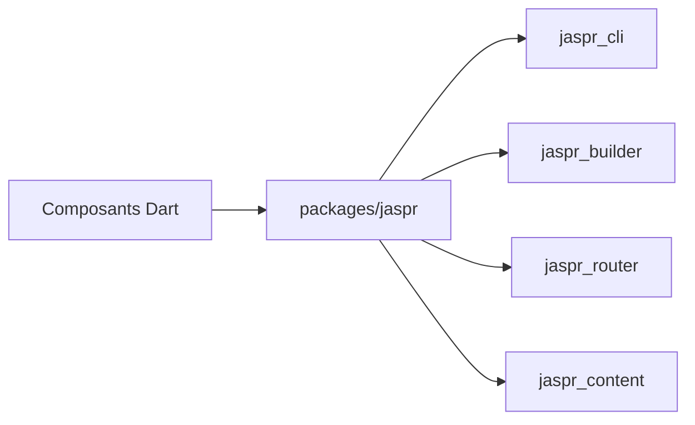

# schultek/jaspr

> Dart web framework, client-side, server-side or static rendering, for Flutter developers building websites.

## The problem
Flutter Web suits applications, not websites: SEO, weight and native HTML are lacking.

## What it actually does
Component model close to Flutter widgets, but with HTML/CSS/DOM output. Native server-side rendering, server-client state synchronization, targeted DOM updates, static generation. Packages: `jaspr`, `jaspr_cli`, `jaspr_router`, `jaspr_content`, `jaspr_riverpod`, `jaspr_flutter_embed`, `jaspr_serverpod`, `jaspr_test`. Online editor JasprPad.

## How it is wired


## Trying it
```bash
# Aucune commande d'installation dans le README :
# renvoie à la documentation (docs.jaspr.site) et à JasprPad.
```

## Cost and gotchas
Free. Own Dart ecosystem, smaller than JavaScript's.

## What it is not
Not Flutter Web: it does not reproduce all of Flutter. Not a data tool.

## Alternatives
Flutter Web, cited in the README as intended for web apps rather than websites.

## For you
Ignore: a Dart web framework, with no direct use in data/AI/MLOps, unless you build interfaces in Flutter.
