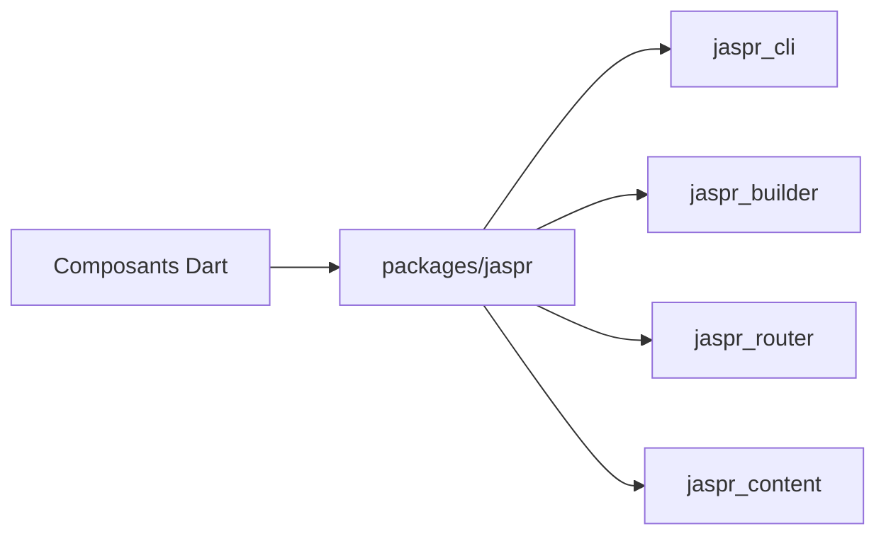

# schultek/jaspr

> Framework web en Dart, rendu côté client, serveur ou statique, pour développeurs Flutter faisant des sites.

## Le problème
Flutter Web convient aux applications, pas aux sites : SEO, poids et HTML natif font défaut.

## Ce que ça fait vraiment
Modèle de composants proche des widgets Flutter, mais sortie HTML/CSS/DOM. Rendu serveur natif, synchronisation d'état serveur-client, mises à jour DOM ciblées, génération statique. Paquets : `jaspr`, `jaspr_cli`, `jaspr_router`, `jaspr_content`, `jaspr_riverpod`, `jaspr_flutter_embed`, `jaspr_serverpod`, `jaspr_test`. Éditeur en ligne JasprPad.

## Comment c'est branché


## Essayer
```bash
# Aucune commande d'installation dans le README :
# renvoie à la documentation (docs.jaspr.site) et à JasprPad.
```

## Coût et pièges
Gratuit. Écosystème Dart propre, plus petit que JavaScript.

## Ce que ce n'est pas
Pas Flutter Web : il ne reproduit pas tout Flutter. Pas un outil data.

## Alternatives
Flutter Web, cité dans le README comme destiné aux web-apps plutôt qu'aux sites.

## Pour toi
À ignorer : framework web Dart, sans usage direct en data/IA/MLOps, sauf si tu fais des interfaces en Flutter.

