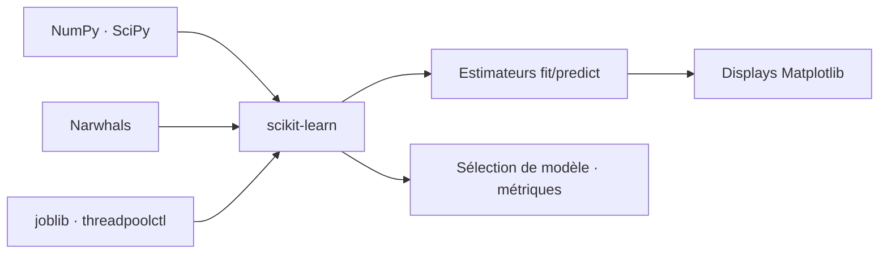

# scikit-learn/scikit-learn

> Python library for classical machine learning, built on SciPy.

## The problem
Reimplementing regression, trees, clustering and cross-validation in every project costs time and introduces silent errors.

## What it actually does
Provides classical ML algorithms with a uniform API (`fit`/`predict`), plus model selection and evaluation tools. Depends on NumPy ≥ 1.26, SciPy ≥ 1.11.4, Narwhals ≥ 2.0.1, joblib, threadpoolctl; Python ≥ 3.12. Matplotlib ≥ 3.8 is required for the `plot_*` functions and `Display` classes. Started in 2007 by David Cournapeau, maintained by a community with the support of several organizations.

## How it is wired


## Trying it
```bash
pip install -U scikit-learn
conda install -c conda-forge scikit-learn
pytest sklearn
```

## Cost and gotchas
Free, BSD 3-clause license. The `SKLEARN_SEED` variable controls randomness during tests. The minimum NumPy/SciPy versions are strict and can constrain an existing environment.

## What it is not
It is not deep learning: no neural networks trainable on GPU. No distributed data handling. The plotting functions are a convenience, not a dataviz library.

## Alternatives
- scikit-image: for image processing, cited as a dependency of examples.

## For you
To adopt without discussion: it is the foundation of tabular ML, and the reference against which to compare any alternative.
