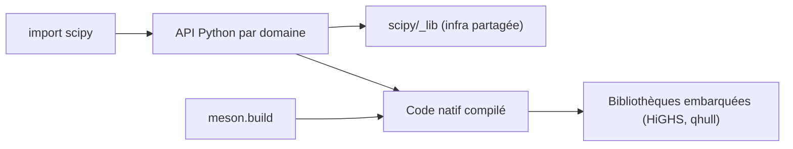

# scipy/scipy

> Python scientific computing library built on NumPy: optimization, linear algebra, statistics, signal processing.

## The problem
Have reliable numerical algorithms (integration, optimization, statistics, FFT, sparse matrices) without rewriting them or linking C or Fortran yourself.

## What it actually does
Subpackages by domain: `optimize`, `linalg`, `sparse`, `stats`, `signal`, `fft`, `integrate`, `interpolate`, `spatial`, `special`, `ndimage`. The Python API calls compiled code (C, C++, Cython, Fortran) and bundled libraries (HiGHS, qhull, SuperLU, ARPACK…). Built with Meson; test suites, benchmarks and Sphinx documentation in the same repository.

## How it is wired

## Trying it
No command in this README: it points to the official installation guide and the development forum.

## Cost and gotchas
Free. Installing from source requires a full build toolchain (C, C++, Fortran); use a prebuilt package. The README mentions a policy on the use of AI for contributions.

## What it is not
Not a deep learning framework or a dataframe tool; it works on NumPy arrays.

## Alternatives
The README names only NumPy, with which SciPy works; no alternative cited.

## For you
Adopt: standard foundation under scikit-learn and a large part of the data stack, backed by NumFOCUS and active (push in September 2026).
