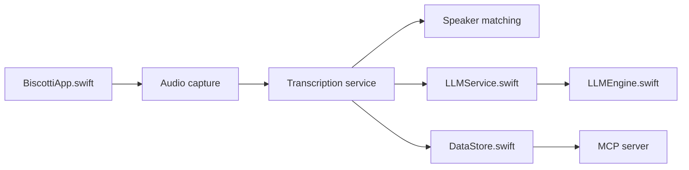

# scosman/Biscotti

> Local macOS meeting recorder: transcribes, identifies speakers and summarizes without the cloud.

## The problem
Meeting-note tools send the audio to their cloud, bring a bot into the call and charge a subscription.

## What it actually does
Captures the Mac's microphone and system audio, with no bot. Transcribes with Whisper V3 Turbo (WhisperKit), separates speakers with Pyannote (SpeakerKit), then generates a summary, action items and a title with Gemma 4 via llama.cpp. It matches voices to past meetings and uses the calendar. It also exposes an MCP server to query the notes from Claude Desktop or LM Studio.

## How it is wired


## Trying it
```bash
brew install biscotti
# ou télécharger Biscotti.dmg et copier Biscotti.app dans Applications
```

## Cost and gotchas
Free, no account. Requires an Apple Silicon Mac (M1+), macOS 15+, 16 GB of RAM recommended; the models must be downloaded the first time. Microphone, system audio and calendar permissions must be granted.

## What it is not
Not cross-platform: macOS only. The README does not state the long-term business model or the license code. Recording without informing participants may be a legal issue depending on the country.

## Alternatives
No alternative named in the README (it only compares to generic "other note apps").

## For you
Worth watching: useful if you want a Whisper + diarization + local LLM pipeline with an MCP server, but the license needs checking and the maintainer is alone.
