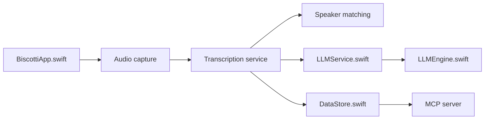

# scosman/Biscotti

> Enregistreur de réunions macOS local : transcrit, identifie les locuteurs et résume sans cloud.

## Le problème
Les outils de notes de réunion envoient l'audio dans leur cloud, font entrer un bot dans l'appel et facturent un abonnement.

## Ce que ça fait vraiment
Capture le micro et l'audio système du Mac, sans bot. Transcrit avec Whisper V3 Turbo (WhisperKit), sépare les locuteurs avec Pyannote (SpeakerKit), puis génère résumé, actions et titre avec Gemma 4 via llama.cpp. Il apparie les voix aux réunions passées et exploite le calendrier. Il expose aussi un serveur MCP pour interroger les notes depuis Claude Desktop ou LM Studio.

## Comment c'est branché


## Essayer
```bash
brew install biscotti
# ou télécharger Biscotti.dmg et copier Biscotti.app dans Applications
```

## Coût et pièges
Gratuit, sans compte. Exige un Mac Apple Silicon (M1+), macOS 15+, 16 Go de RAM recommandés ; les modèles sont à télécharger une première fois. Permissions micro, audio système et calendrier à accorder.

## Ce que ce n'est pas
Pas multiplateforme : macOS seulement. Le README ne précise pas le modèle économique à long terme ni le code de licence. Enregistrer sans prévenir les participants peut poser un problème légal selon les pays.

## Alternatives
Aucune alternative nommée dans le README (il compare seulement à des « autres apps de notes » génériques).

## Pour toi
Surveiller : utile si tu veux un pipeline Whisper + diarisation + LLM local avec un serveur MCP, mais la licence est à vérifier et le mainteneur est seul.

