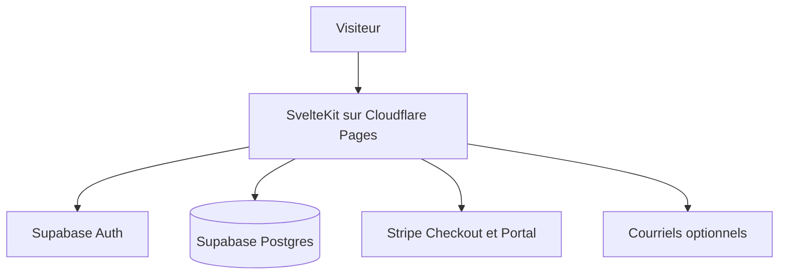

# scosman/CMSaasStarter

> SvelteKit template for a SaaS site with authentication, Stripe subscriptions, blog and dashboard.

## The problem
Starting a SaaS product means redoing authentication, billing, the pricing page and the marketing site.

## What it actually does
A SvelteKit, Tailwind and DaisyUI template: sign-up and login via Supabase Auth, Stripe subscriptions and portal, pricing page, blog with RSS, serverless search, emails, contact form. The README suggests hosting on Cloudflare Pages and Workers.

## How it is wired
Simplified diagram based on the card, no diagram provided.



## Trying it
```bash
git pull [Your Repo Created Above]
cd CMSaasStarter
npm install
cp .env.example .env.local
npm run dev -- --open
```

## Cost and gotchas
Free template; suggested hosting at 0 dollars a month (free Supabase and Cloudflare, no backups, database paused after 7 days) or about 30 dollars a month on a paid plan. Supabase and Stripe accounts are indispensable.

## What it is not
Not a finished product: it needs lengthy configuration (SQL, Stripe, authentication callbacks) and then you have to write the actual SaaS function. The last push dates from March 2026.

## Alternatives
None cited in the README.

## For you
Ignore: useful for launching a web SaaS, but unrelated to your data / AI practice; only worth picking up for a product showcase site.
