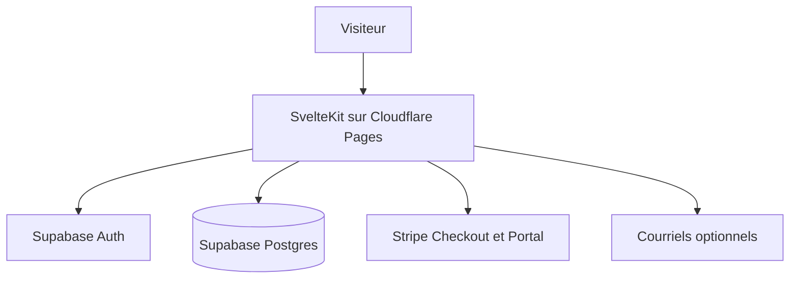

# scosman/CMSaasStarter

> Modèle SvelteKit de site SaaS avec authentification, abonnements Stripe, blog et tableau de bord.

## Le problème
Démarrer un produit SaaS oblige à refaire l'authentification, la facturation, la page de prix et le site marketing.

## Ce que ça fait vraiment
Un gabarit SvelteKit, Tailwind et DaisyUI : inscription et connexion via Supabase Auth, abonnements et portail Stripe, page de prix, blog avec RSS, recherche sans serveur, courriels, formulaire de contact. Le README propose un hébergement Cloudflare Pages et Workers.

## Comment c'est branché
Schéma simplifié d'après la fiche, sans diagramme fourni.



## Essayer
```bash
git pull [Your Repo Created Above]
cd CMSaasStarter
npm install
cp .env.example .env.local
npm run dev -- --open
```

## Coût et pièges
Modèle gratuit ; hébergement suggéré à 0 dollar par mois (Supabase et Cloudflare gratuits, sans sauvegarde, base mise en pause après 7 jours) ou environ 30 dollars par mois en offre payante. Comptes Supabase et Stripe indispensables.

## Ce que ce n'est pas
Pas un produit fini : il faut le configurer longuement (SQL, Stripe, rappels d'authentification) puis écrire la vraie fonction SaaS. Le dernier envoi date de mars 2026.

## Alternatives
Aucune citée dans le README.

## Pour toi
À ignorer : utile pour lancer un SaaS web, mais sans rapport avec ta pratique data / IA ; à reprendre seulement pour une vitrine de produit.

