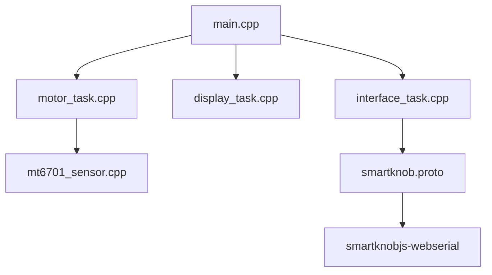

# scottbez1/smartknob

> DIY brushless-motor rotary knob that simulates detents and software end stops, for electronics hobbyists.

## The problem
A physical knob has a fixed feel. Here, the feel (detents, end stops) is set by software.

## What it actually does
A gimbal motor and a magnetic encoder form a closed torque loop. The ESP32 firmware reads the position, applies the torque, displays on a round screen and talks to a host over USB serial (protobuf). Web, Node and Python clients exist. The README also announces press detection and a light sensor, absent from the sampled code.

## How it is wired
Diagram based on the provided diagram, reduced.

## Trying it
The README gives no build command here. It cites the PlatformIO `view` (or `nanofoc`) environment for uploading the firmware, and the web demo https://scottbez1.github.io/smartknob/ with an already assembled device.

## Cost and gotchas
You have to order PCBs, 3D-printed parts and a motor (under $200 of parts, the author's estimate). Very fine SMD soldering, hardware troubleshooting is on you. License present but not identified by GitHub.

## What it is not
Not a product: no kit sold, no productive use yet ("Does it work with XYZ? Not yet"). The README says so: not recommended except for advanced hobbyists. No software for your daily data work.

## Alternatives
- NanoFOC DevKit++ (cited in the README): simpler board to test haptic feedback, the SmartKnob firmware runs on it.

## For you
Ignore: a hardware project for electronics people, unrelated to data, AI or MLOps, and inactive since February 2024.
