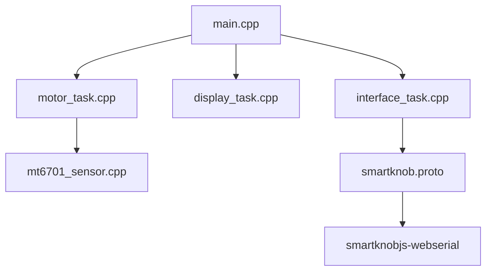

# scottbez1/smartknob

> Bouton rotatif DIY à moteur sans balais qui simule des crans et des butées logicielles, pour bricoleurs électroniciens.

## Le problème
Un bouton physique a un toucher figé. Ici, le ressenti (crans, butées) se règle par logiciel.

## Ce que ça fait vraiment
Un moteur gimbal et un encodeur magnétique forment une boucle de couple fermée. Le firmware ESP32 lit la position, applique le couple, affiche sur un écran rond et parle à un hôte par série USB (protobuf). Des clients web, Node et Python existent. Le README annonce aussi détection de pression et capteur de lumière, absents du code échantillonné.

## Comment c'est branché
Schéma d'après le diagramme fourni, réduit.

## Essayer
Le README ne donne pas de commande de compilation ici. Il cite l'environnement PlatformIO `view` (ou `nanofoc`) pour téléverser le firmware, et la démo web https://scottbez1.github.io/smartknob/ avec un appareil déjà monté.

## Coût et pièges
Il faut commander cartes PCB, pièces imprimées en 3D et moteur (moins de 200 $ de pièces, estimation de l'auteur). Soudure CMS très fine, dépannage matériel à ta charge. Licence présente mais non identifiée par GitHub.

## Ce que ce n'est pas
Pas un produit : pas de kit vendu, pas encore d'usage productif ("Does it work with XYZ ? Not yet"). Le README le dit : non recommandé hors bricoleur avancé. Pas de logiciel pour ton quotidien data.

## Alternatives
- NanoFOC DevKit++ (cité dans le README) : carte plus simple pour tester le retour haptique, le firmware SmartKnob tourne dessus.

## Pour toi
À ignorer : projet de hardware pour électroniciens, sans lien avec data, IA ou MLOps, et inactif depuis février 2024.

