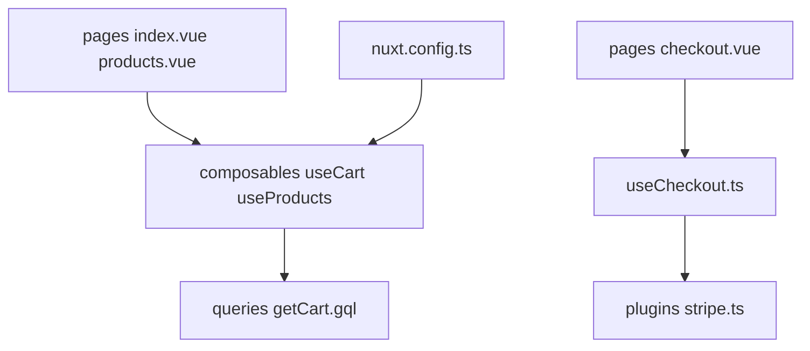

# scottyzen/woonuxt

> Nuxt 4 front end for WooCommerce, via WPGraphQL, static or hybrid ISR.

## The problem
A classic WooCommerce store is slow and rigid, and hard to turn into a decoupled site.

## What it actually does
The Nuxt pages call composables (cart, checkout, products) that query WPGraphQL using `.gql` files. The project covers cart, search, accounts, coupons, Stripe, PayPal, PWA and seven languages. Customization goes through Nuxt layers: `woonuxt_base` is the parent theme.

## How it is wired


## Trying it
```bash
npm install
npm run dev
npm run update:woonuxt -- --dry-run
```

## Cost and gotchas
Free, but it needs a WordPress with WooCommerce, WPGraphQL, WooGraphQL and the "Settings for WooNuxt" plugin. The `GQL_HOST` and `NUXT_IMAGE_DOMAINS` variables must be set. A recent Node is required by Nuxt 4.6. GPL license.

## What it is not
Not a standalone store: it depends on WordPress in the background. No sales analytics tool.

## Alternatives
No alternative named in the README.

## For you
Ignore: an e-commerce storefront, unrelated to data or MLOps.
