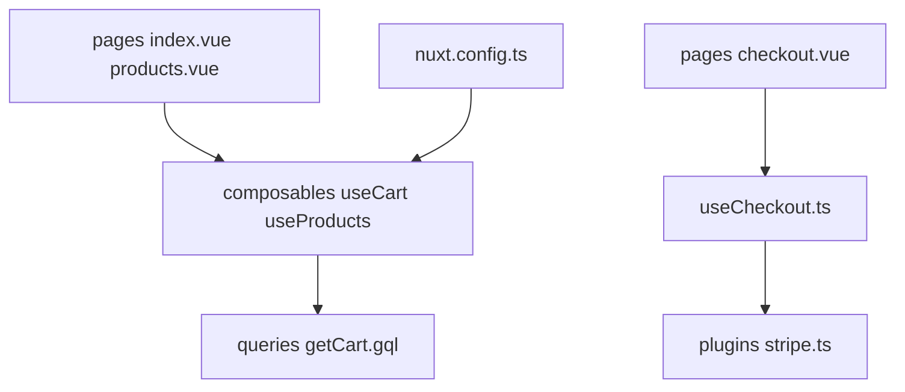

# scottyzen/woonuxt

> Front-end Nuxt 4 pour WooCommerce, via WPGraphQL, en statique ou en ISR hybride.

## Le problème
Une boutique WooCommerce classique est lente et rigide, difficile à passer en site découplé.

## Ce que ça fait vraiment
Les pages Nuxt appellent des composables (panier, paiement, produits) qui interrogent WPGraphQL avec des fichiers `.gql`. Le projet couvre panier, recherche, comptes, coupons, Stripe, PayPal, PWA et sept langues. La personnalisation passe par les couches Nuxt : `woonuxt_base` est le thème parent.

## Comment c'est branché


## Essayer
```bash
npm install
npm run dev
npm run update:woonuxt -- --dry-run
```

## Coût et pièges
Gratuit, mais il faut un WordPress avec WooCommerce, WPGraphQL, WooGraphQL et le plugin « Settings for WooNuxt ». Variables `GQL_HOST` et `NUXT_IMAGE_DOMAINS` à renseigner. Node récent exigé par Nuxt 4.6. Licence GPL.

## Ce que ce n'est pas
Pas une boutique autonome : il dépend de WordPress en arrière-plan. Pas d'outil d'analyse de ventes.

## Alternatives
Aucune alternative nommée dans le README.

## Pour toi
Ignorer : vitrine e-commerce, sans lien avec la data ou le MLOps.

