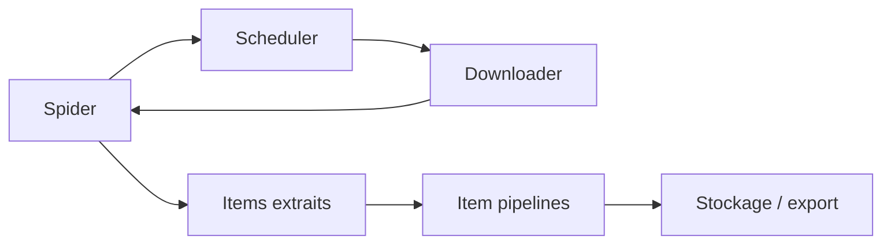

# scrapy/scrapy

> Python framework for extracting structured data from websites.

## The problem
Writing a crawler by hand means handling the URL queue, concurrency, retries and parsing yourself.

## What it actually does
The README provided is only a few lines long: a web scraping framework for extracting structured data, cross-platform, Python 3.10+, maintained by Zyte (formerly Scrapinghub) and many contributors. The rest of the content points to the online documentation and the contribution guide.

## How it is wired


## Trying it
```bash
pip install scrapy
```

## Cost and gotchas
Free. The README states neither license, dependencies nor network constraints; everything is deferred to the docs.

## What it is not
The README describes neither JavaScript rendering, nor proxy handling, nor robots.txt policy: all points to check elsewhere. Not a turnkey no-code tool.

## Alternatives
No alternative named in the README.

## For you
Adopt it for any recurring web collection, but the README material is insufficient: the docs are the real entry point.
