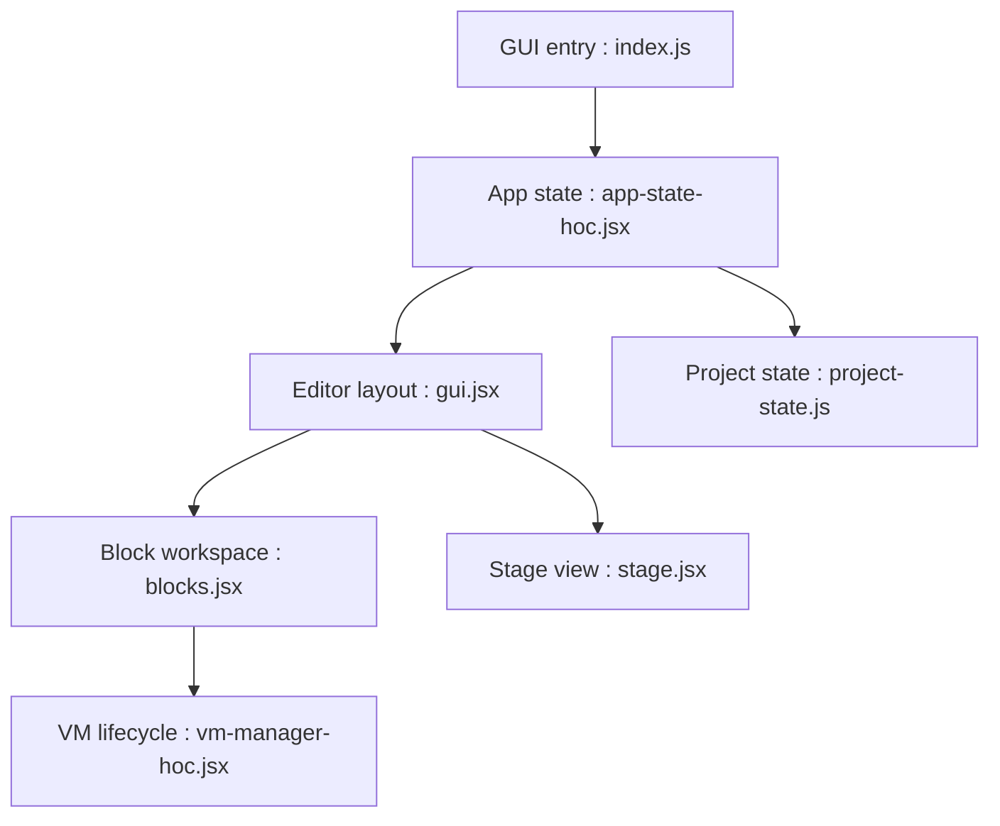

# scratchfoundation/scratch-gui

> React components of the Scratch 3.0 interface, now migrated to the scratch-editor monorepo.

## The problem
Providing the interface to create and run Scratch 3.0 projects.

## What it actually does
A set of React components: block editor, stage, costume and sound editors, libraries, tutorials, backpack, cloud connection. A state machine (`project-state.js`) handles loading, display and saving. The project runs on the Scratch VM.

## How it is wired


## Trying it
```bash
git clone https://github.com/scratchfoundation/scratch-gui.git
cd scratch-gui
npm install
npm start
```

## Cost and gotchas
Free. Archived repository: new issues and PRs go elsewhere. AGPL-3.0 license: code publication obligations for a network service. Heavy git history (`--depth=1` recommended).

## What it is not
Not the maintained version: the continuation lives in scratch-editor, published as `@scratch/scratch-gui`.

## Alternatives
- scratch-editor: the monorepo that replaces this repository.

## For you
Ignore: archived and under AGPL; if Scratch interests you, start from the monorepo.
