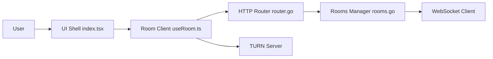

# screego/server

> Self-hosted, low-latency WebRTC screen-sharing server for showing code.

## The problem
Corporate video-conferencing tools share the screen with lag or quality too low to read code.

## What it actually does
Very short README: multi-user sharing via WebRTC, built-in TURN, single binary or Docker.
Based on the architecture: React UI, Go HTTP router with auth, WebSocket signaling per room, media peer-to-peer possibly relayed by TURN.

## How it is wired

## Trying it
No command documented in the README (points to external Installation and Configuration pages).

## Cost and gotchas
Free, GPL-3.0. NAT traversal to configure (TURN).

## What it is not
Not a video-conferencing tool: screen sharing only, as a complement to another solution.

## Alternatives
None named in the README.

## For you
To ignore: a collaboration utility unrelated to data; README too thin to say more.
