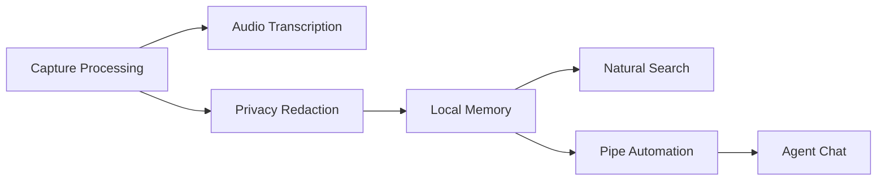

# screenpipe/screenpipe

> Local screen and audio capture, indexed and queryable by AI and agents, for workstations.

## The problem
We forget what we saw, heard or did; finding information from a meeting or a screen is painful.

## What it actually does
Event-driven capture (accessibility tree, OCR as fallback), audio transcription (local Whisper or Deepgram), SQLite storage with full-text search, REST API on localhost:3030 and an MCP server. "Pipes" (scheduled agents described in markdown) run summaries, meeting notes, etc. Tauri desktop app.

## How it is wired


## Trying it
```bash
npx screenpipe record
npx screenpipe setup
claude mcp add screenpipe -- npx -y screenpipe-mcp@latest
```

## Cost and gotchas
"Source-available" license: personal non-commercial use only, commercial license otherwise; paid Free/Basic/Business plans. PostHog and Sentry telemetry enabled by default; CPU 5-20%, RAM 0.5-3 GB. Official build behind a paywall.

## What it is not
Not 100% local: cloud AI, sync and integrations send data. The main branch is unstable according to the author.

## Alternatives
Rewind.ai/Limitless, Microsoft Recall, Granola, Otter.ai (compared by the author).

## For you
Watch: useful for giving your coding assistants context via MCP, but full screen capture and the non-commercial license call for caution.
