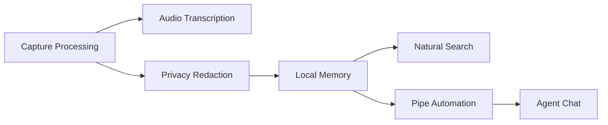

# screenpipe/screenpipe

> Capture écran et audio en local, indexée et interrogeable par IA et agents, pour postes de travail.

## Le problème
On oublie ce qu'on a vu, entendu ou fait ; retrouver une info d'une réunion ou d'un écran est pénible.

## Ce que ça fait vraiment
Capture événementielle (arbre d'accessibilité, OCR en repli), transcription audio (Whisper local ou Deepgram), stockage SQLite avec recherche plein texte, API REST sur localhost:3030 et serveur MCP. Des « pipes » (agents planifiés décrits en markdown) lancent des résumés, comptes rendus, etc. Appli de bureau Tauri.

## Comment c'est branché


## Essayer
```bash
npx screenpipe record
npx screenpipe setup
claude mcp add screenpipe -- npx -y screenpipe-mcp@latest
```

## Coût et pièges
Licence « source-available » : usage personnel non commercial seulement, licence commerciale sinon ; plans Free/Basic/Business payants. Télémétrie PostHog et Sentry activée par défaut ; CPU 5-20 %, RAM 0,5-3 Go. Build officiel derrière paywall.

## Ce que ce n'est pas
Pas 100 % local : IA cloud, sync et intégrations envoient des données. La branche main est instable selon l'auteur.

## Alternatives
Rewind.ai/Limitless, Microsoft Recall, Granola, Otter.ai (comparés par l'auteur).

## Pour toi
Surveiller : utile pour donner du contexte à tes assistants de code via MCP, mais la capture totale de l'écran et la licence non commerciale exigent prudence.

