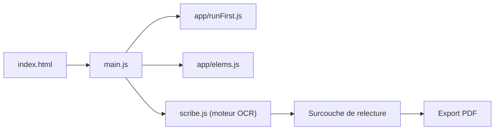

# scribeocr/scribeocr

> Web application for local, in-browser OCR, to proofread results and produce searchable PDFs.

## The problem
OCR tools add a poorly positioned invisible text, and fixing errors is slow. You also need faithful, lightweight scanned documents.

## What it actually does
An interface that overlays the editable OCR text on the image, colors low-confidence words and generates a font fitted to the document for better alignment. It exports a standard PDF (invisible text) or an "ebook mode" PDF with native text. Recognition comes from the separate Scribe.js repository (submodule); everything happens in the browser, with nothing sent to a server.

## How it is wired


## Trying it
```bash
git clone --recursive https://github.com/scribeocr/scribeocr.git
cd scribeocr
npm i
npx http-server
```

## Cost and gotchas
Free; public site scribeocr.com or a local HTTP server (no desktop application). Cloning requires `--recursive` for the submodule.

## What it is not
It is not the OCR engine: quality questions go to the Scribe.js repository. Nor is it a library to embed.

## Alternatives
- Scribe.js: the recognition library to integrate into your own project.
- Tesseract HOCR: an input format the tool can correct.

## For you
Watch: useful for digitizing and correcting document corpora before an AI pipeline, with 100% local processing; note the AGPL.
