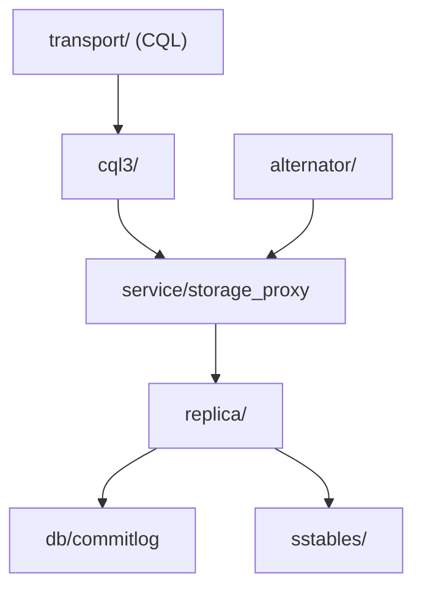

# scylladb/scylladb

> Distributed database written in C++, compatible with Cassandra and DynamoDB, for high-throughput workloads.

## The problem
JVM-based NoSQL databases need a lot of hardware to sustain high throughput and stable latency.

## What it actually does
Shared-nothing server partitioned per core, built on Seastar. Three entry points: CQL, Alternator (DynamoDB API, must be enabled) and an admin REST API. Writes go through commitlog, memtable, SSTables and compaction. Topology is handled by gossip and Raft. This repository is the source code, not a ready-to-use package.

## How it is wired


## Trying it
```bash
git submodule update --init --force --recursive
./tools/toolchain/dbuild ./configure.py
./tools/toolchain/dbuild ninja build/release/scylla
./tools/toolchain/dbuild ./build/release/scylla --workdir tmp --smp 1 --developer-mode 1
```

## Cost and gotchas
Demanding C++23 build, hence the pinned Docker toolchain. Developer mode disables performance checks. `ent/` modules exist in the tree.

## What it is not
Not a lightweight tool nor a turnkey service: the README describes how to compile it. A license is present but not identified by GitHub; check it before use.

## Alternatives
Apache Cassandra and Amazon DynamoDB are cited as the compatible APIs.

## For you
Worth watching: relevant for massive storage of features or events, but check the license before any deployment.
