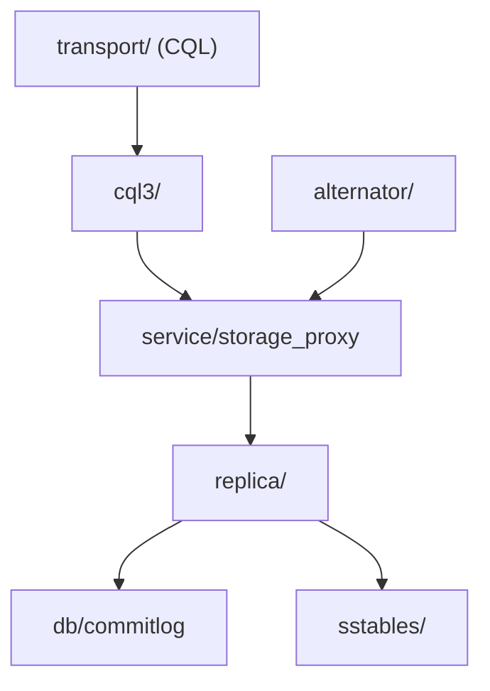

# scylladb/scylladb

> Base de données distribuée en C++, compatible Cassandra et DynamoDB, pour charges à fort débit.

## Le problème
Les bases NoSQL JVM demandent beaucoup de matériel pour tenir un débit élevé et une latence stable.

## Ce que ça fait vraiment
Serveur shared-nothing partitionné par cœur, construit sur Seastar. Trois portes d'entrée : CQL, Alternator (API DynamoDB, à activer) et API REST d'admin. Écritures via commitlog, memtable, SSTables et compaction. Topologie par gossip et Raft. Ce dépôt est le code source, pas un paquet prêt à l'emploi.

## Comment c'est branché


## Essayer
```bash
git submodule update --init --force --recursive
./tools/toolchain/dbuild ./configure.py
./tools/toolchain/dbuild ninja build/release/scylla
./tools/toolchain/dbuild ./build/release/scylla --workdir tmp --smp 1 --developer-mode 1
```

## Coût et pièges
Compilation C++23 exigeante, d'où la toolchain Docker figée. Le mode développeur désactive les contrôles de performance. Des modules `ent/` existent dans l'arborescence.

## Ce que ce n'est pas
Pas un outil léger ni un service clé en main : le README décrit la compilation. Licence présente mais non identifiée par GitHub, à vérifier avant usage.

## Alternatives
Apache Cassandra et Amazon DynamoDB sont cités comme les API compatibles.

## Pour toi
À surveiller : pertinent pour du stockage massif de features ou d'événements, mais vérifie la licence avant tout déploiement.

